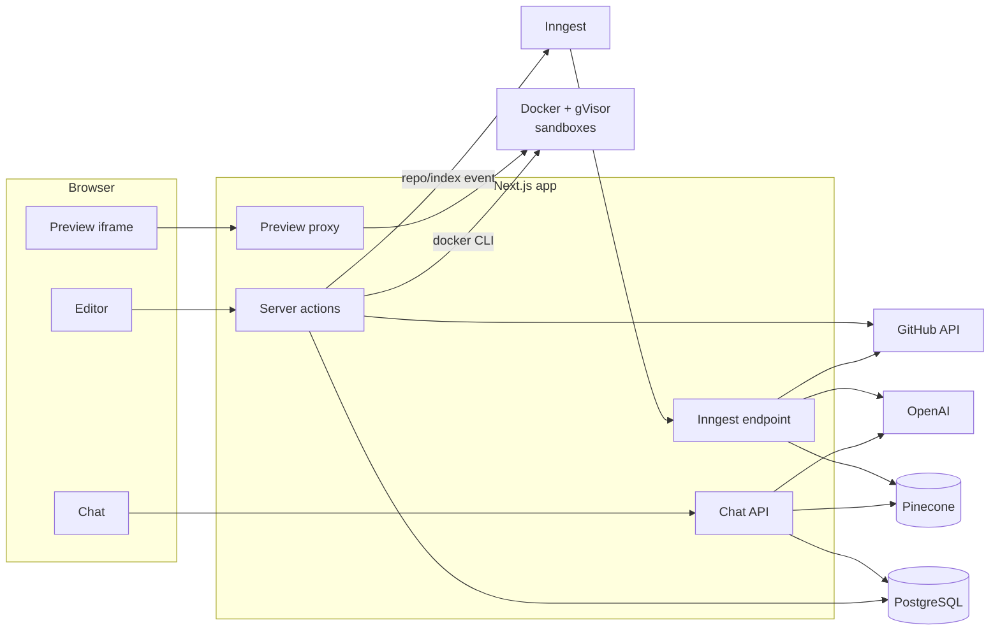

# CoderArena

CoderArena is a browser-based development platform. You write code in a VS Code–style editor, run it in an isolated sandbox with a live preview, open your GitHub repositories in that same environment, and ask an AI assistant questions about any repository's code.

Everything runs in the browser: no local setup, no cloning, no `npm install` on your machine.

---

## Contents

- [Features](#features)
- [How it works](#how-it-works)
- [Tech stack and why](#tech-stack-and-why)
- [Getting started](#getting-started)
- [Environment variables](#environment-variables)
- [Scripts](#scripts)
- [Project structure](#project-structure)
- [Deploying to production](#deploying-to-production)
- [Security](#security)
- [Limitations and roadmap](#limitations-and-roadmap)

---

## Features

### Playgrounds

A playground is a small project you create from a template and edit in the browser.

- **Templates**: React, Next.js, Vue, Angular and TypeScript (frontend, with live preview), plus Express and Hono (backend, editor only for now).
- **Editor**: Monaco, the editor inside VS Code, with TypeScript/JavaScript IntelliSense, Emmet for HTML, CSS and JSX, a file explorer and resizable panels.
- **Settings**: eight editor themes (VS Code Dark/Light, One Dark, Dracula, Monokai, Nord, GitHub Dark/Light), font family and font size, saved to your account.
- **Autosave**: unsaved changes are saved every few seconds. Only files that changed are sent, and you're warned before leaving with unsaved work.
- **Organize**: star, rename and delete playgrounds; starred ones stay at the top of the dashboard.
- **Terminal panel**: a read-only shell over the project's files (`ls`, `cd`, `cat`, `tree`, …).

### Live preview in a sandbox

Press **Run** and the playground starts in its own Docker container, isolated with gVisor. The app's dev server runs inside the container, and its output appears in the preview panel next to the editor.

- Edits after the first run upload only the changed files, then the preview reloads.
- Changing dependencies in `package.json` restarts the sandbox, which installs them.
- Build errors (for example from Angular) are shown in the preview panel with the compiler's output.
- Idle sandboxes are cleaned up automatically.

### GitHub integration

- **Sign in with GitHub**, or sign up with email and connect GitHub later from the GitHub page or Settings.
- **Repository list**: sync every repository your account can reach (personal, collaborator and organization), then search and page through them. Each card shows visibility, default branch and last push.
- **Open in playground**: copy a repository's code into a new playground and run it in a sandbox. The template, and therefore the sandbox, is picked from the repository's `package.json`. Private repositories work through your connected account.
- **Import by URL**: open any public repository by pasting its link, even without connecting GitHub.

### Repository chat

A dedicated chat section where you ask questions about a repository's code.

1. On the GitHub page, click **Index for chat**. A background job reads the repository's code, splits it into chunks and stores their embeddings.
2. Open the repository in **Chat** and ask anything: how authentication works, where the entry point is, what a module does.
3. Answers stream in as they're written and list the source files they drew on, each linking to the file on GitHub.

The conversation is saved per repository and the assistant remembers the last few messages, so follow-up questions work. You can re-index after pushing changes or clear the conversation at any time.

---

## How it works



- **Running code**: a server action starts a container from the template's image, uploads the files as a tar stream through `docker exec`, waits for the dev server, and returns a preview URL. The preview proxy forwards requests to the container under `/api/sandbox/preview/<token>/`.
- **Importing a repository**: the app downloads the repository as one tarball from GitHub, keeps the text files the editor can open (leaving out lockfiles, binaries and build output), detects the template and saves the files as a playground.
- **Indexing**: an Inngest function lists the repository's files, then processes them in batches of 20, one durable step per batch. Each batch is fetched from GitHub, split into 2,000-character chunks, embedded with OpenAI and stored in Pinecone under that repository's own namespace.
- **Chatting**: the question is embedded, the 8 most similar chunks are retrieved from the repository's namespace, and the model answers from that context, streaming its reply back as it's written.

---

## Tech stack and why

| Area | Technology | Why |
| --- | --- | --- |
| Framework | **Next.js 16** (App Router), **React 19**, TypeScript | Server components and server actions read the database directly, so most pages need no separate API layer. Route handlers cover the two things that do: the streaming chat endpoint and the preview proxy. |
| Database | **PostgreSQL** + **Prisma 7** | The data is relational (users → playgrounds → files, repositories → chat messages) and needs transactions: a save writes every changed file atomically, with the ownership check in the same transaction. Prisma provides typed queries and versioned migrations. One database for everything keeps operations simple. |
| Authentication | **Better Auth** | Self-hosted, with users and sessions in our own Postgres. Supports email & password and GitHub OAuth with account linking, and refreshes the GitHub access token when needed, which the background indexing job relies on. |
| Editor | **Monaco** (+ `emmet-monaco-es`), **xterm.js**, **react-resizable-panels** | Monaco is VS Code's editor, so users get familiar keybindings and real TypeScript IntelliSense. xterm.js renders the terminal panel, and resizable panels give the IDE layout. |
| Sandboxes | **Docker** + **gVisor** (`runsc`) | Playgrounds run untrusted code. Docker gives each one its own filesystem, CPU and memory limits, and gVisor adds a user-space kernel between that code and the host's Linux kernel. Images have each template's dependencies preinstalled, so a sandbox starts in seconds. |
| GitHub | **Octokit** | The official, typed GitHub API client: listing repositories, reading files for indexing. |
| Background jobs | **Inngest** | Indexing a repository takes minutes and makes hundreds of API calls. Inngest runs it outside the request as durable steps: a failed batch is retried on its own, and progress survives restarts. |
| AI | **OpenAI** `text-embedding-3-small` (512 dimensions), `gpt-4o-mini` | The small embedding model at 512 dimensions keeps storage and cost low with good retrieval quality; `gpt-4o-mini` answers quickly and cheaply. |
| Vector search | **Pinecone** | Managed vector database: nothing to operate. Each repository gets its own namespace, so re-indexing clears exactly that repository's data first. |
| Chat rendering | **Streamdown** | Renders Markdown correctly while it's still streaming (half-finished code blocks and lists), with syntax-highlighted code. |
| UI | **Tailwind CSS 4**, **shadcn/ui** on **Base UI**, **lucide** / **simple-icons**, **motion** | Accessible primitives whose code lives in the repo and can be changed freely, consistent styling with light and dark themes, and brand icons for templates. |

---

## Getting started

### Prerequisites

- **Node.js 20.9+** and npm
- **PostgreSQL** 14+
- **Docker** (Docker Desktop on macOS/Windows), needed only for the live preview
- A **GitHub OAuth app** ([create one](https://github.com/settings/developers)) with the callback URL `http://localhost:3000/api/auth/callback/github`
- An **OpenAI** API key and a **Pinecone** index with **512 dimensions**, needed only for repository chat

### 1. Clone and install

```bash
git clone https://github.com/ManishC31/CoderArena.git
cd CoderArena
npm install
```

### 2. Configure

```bash
cp .env.example .env
```

Fill in `.env` (see [Environment variables](#environment-variables)). Generate the auth secret with `openssl rand -base64 32`.

### 3. Create the database

```bash
npm run db:migrate
```

### 4. Start the sandbox host (for previews)

Docker Desktop can't add the gVisor runtime, so in development the sandboxes run on a "sandbox host": a Docker engine with gVisor inside a privileged container.

```bash
npm run sandbox:host    # Docker API on 127.0.0.1:2375, preview ports 42000–42019
npm run sandbox:build   # build the template images on it
```

Then add the `SANDBOX_*` settings from `.env.example` to `.env.local`. Run `npm run sandbox:host` again after Docker restarts. Details: [`sandbox/README.md`](sandbox/README.md).

### 5. Run

```bash
npm run dev       # the app, on http://localhost:3000
npm run inngest   # in a second terminal: the Inngest dev server, needed for "Index for chat"
```

Sign up, create a playground and press **Run**. To try GitHub features, connect your account on the GitHub page and sync your repositories.

---

## Environment variables

| Variable | Required | Description |
| --- | --- | --- |
| `DATABASE_URL` | Yes | PostgreSQL connection string |
| `BETTER_AUTH_SECRET` | Yes | Random secret for signing sessions |
| `BETTER_AUTH_URL` | Yes | Public URL of the app, e.g. `http://localhost:3000` |
| `GITHUB_CLIENT_ID`, `GITHUB_CLIENT_SECRET` | Yes | GitHub OAuth app; callback `{BETTER_AUTH_URL}/api/auth/callback/github` |
| `OPENAI_API_KEY` | For chat | Embeddings and answers |
| `PINECONE_API_KEY`, `PINECONE_INDEX` | For chat | Vector index (512 dimensions) |
| `INNGEST_DEV` | Development | `1` to use the local Inngest dev server |
| `INNGEST_EVENT_KEY`, `INNGEST_SIGNING_KEY` | Production | Inngest keys; remove `INNGEST_DEV` |
| `SANDBOX_DOCKER_HOST` | Optional | Docker engine for sandboxes; unset uses the local one. Development: `tcp://127.0.0.1:2375` |
| `SANDBOX_PUBLISH_ADDRESS`, `SANDBOX_PORT_RANGE` | Optional | Where preview ports are published. The port range also caps how many sandboxes run at once |
| `SANDBOX_RUNTIME`, `SANDBOX_DNS`, `SANDBOX_PREVIEW_PORT` | Optional | See `.env.example` |

---

## Scripts

| Command | What it does |
| --- | --- |
| `npm run dev` | Start the app in development |
| `npm run build` / `npm start` | Production build and server |
| `npm run inngest` | Local Inngest dev server, connected to the app |
| `npm run db:migrate` | Create and apply migrations (development) |
| `npm run db:deploy` | Apply migrations (production) |
| `npm run db:studio` | Browse the database in Prisma Studio |
| `npm run sandbox:host` | Start the development sandbox host |
| `npm run sandbox:build` | Build the sandbox images |
| `npm run lint` | ESLint |

---

## Project structure

```
prisma/
  schema/                 one file per model (user, playground, github-repository, ...)
  migrations/
sandbox/
  images/<template>/      Docker image per sandbox template
  host/                   development sandbox host and the production firewall rules
src/
  app/
    (auth)/               login and sign-up
    (app)/(shell)/        dashboard, playgrounds, GitHub, chat, settings
    (app)/playground/     the editor, and playground server actions
    api/                  auth, chat (streaming), Inngest, sandbox preview proxy
  components/             UI, by feature (playground, github, chat, dashboard, ...)
  lib/
    sandbox/              container lifecycle, file uploads, preview proxy
    ai/                   OpenAI, Pinecone, chat prompt
    inngest/              background jobs (repository indexing)
    github.ts             GitHub tokens and API
    github-import.ts      repository → playground import
    auth.ts               Better Auth configuration
```

---

## Deploying to production

The app runs on a Linux server (a full VM: the sandboxes need Docker with gVisor):

1. **App**: `npm ci && npm run build && npm run db:deploy`, then run `npm start` as **a single instance** (for example under systemd) behind Caddy or nginx with HTTPS. Sandbox bookkeeping is kept in the app's memory, so it can't run on serverless platforms or as several replicas.
2. **Sandboxes**: install Docker and gVisor (`sudo runsc install`), set `"icc": false` in `/etc/docker/daemon.json`, apply `sandbox/host/egress-rules.sh` after every Docker start, and build the images with `npm run sandbox:build`. Full steps: [`sandbox/README.md`](sandbox/README.md#production-linux).
3. **Inngest**: self-host the Inngest server or use Inngest Cloud; set `INNGEST_EVENT_KEY` and `INNGEST_SIGNING_KEY` and register `https://<your-domain>/api/inngest`. Give the reverse proxy a generous read timeout (e.g. 300 s): each indexing batch is one request.
4. **GitHub**: create a production OAuth app with callback `https://<your-domain>/api/auth/callback/github`, and set `BETTER_AUTH_URL` to your domain.

Capacity: each sandbox gets 1 GB of memory and 1 CPU, with at most 2 per user and 20 in total. Use `SANDBOX_PORT_RANGE` to lower the total on smaller servers.

---

## Security

- **Sandboxed code** runs as a non-root user under gVisor, with all capabilities dropped, memory/CPU/process limits, a 15-minute idle timeout and a 2-hour maximum lifetime.
- **Network**: sandboxes reach the public internet (for npm) but not the host, private networks, cloud metadata or each other.
- **Previews** load in an iframe with an opaque origin (`sandbox` without `allow-same-origin`, plus a `Content-Security-Policy: sandbox` header), so preview code can't read the app's cookies or pages. The preview proxy forwards no credentials.
- **Data access**: every query is scoped to the signed-in user; other users' playgrounds, repositories and chats return 404.
- **GitHub tokens** are never sent to the browser or stored in background-job payloads; jobs look them up server-side when they run.

---

## Limitations and roadmap

**Current limitations**

- Previews have no hot module replacement: the page reloads after each change.
- An imported repository opens with up to 200 text files; larger repositories are rejected, and images and other binary files are left out.
- Imported apps that need their own database or secrets will start, but pages that depend on them won't work: sandboxes can't reach private networks.
- Express and Hono playgrounds can be edited but not run yet.

**Planned**

- Push a playground to GitHub as a new repository
- Interview practice: algorithm problems and real-world development challenges, with submissions and evaluation
